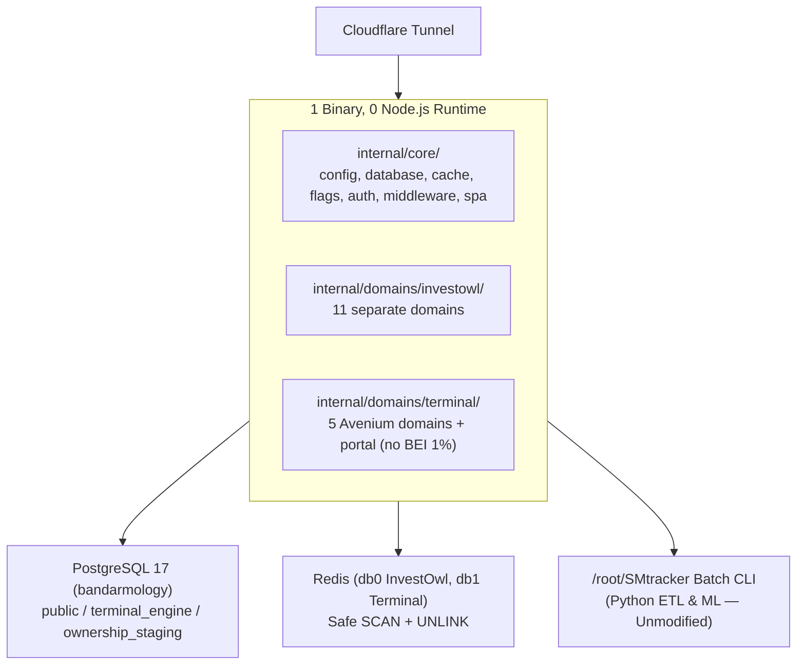

# LazyTrader

**LazyTrader** is the unified fusion of **InvestOwl** and **Avenium Terminal** into a **single, ultra-lightweight application**: one static Go binary that serves both the JSON API and the React single-page application — no Node.js runtime in production.

The fusion preserves **100% of InvestOwl's UI & UX**, **100% of Avenium's features** (with one deliberate exception, the BEI 1% module — see below), and **zero changes** to any mathematical formula, scoring weight, business logic, or the `SMtracker` ML/ETL pipeline. Every migrated endpoint is verified against the legacy systems with a strict golden-JSON parity harness before it is allowed to ship.

> **Live in production:** [https://terminal.avenia.my.id](https://terminal.avenia.my.id)


---

## Why LazyTrader?

Before the fusion, InvestOwl and Avenium ran as **four separate services** (two Python/FastAPI backends and two Node.js frontends) consuming roughly **~1,019 MiB of RAM** and **~1.48 GiB of disk**. LazyTrader replaces all of them with **one Go binary**:

| Metric | Legacy (4 services) | LazyTrader (1 binary) | Improvement |
| :--- | :--- | :--- | :--- |
| RAM (post-load) | ~1,019 MiB | **32.8 MiB** | **−96.8%** |
| RAM (idle, production) | — | **~13.6 MiB** | — |
| Disk footprint | ~1.48 GiB | **19.8 MiB** | **−98.7%** |
| API latency | baseline | **2.45×–193× faster** | — |
| Parity test suite | — | **142/142 PASS** | 0 mismatches |

This makes the full platform viable on a small 3.6 GB ARM64/AMD64 server while keeping byte-for-byte behavioural parity with the systems it replaces.

---

## Features

### InvestOwl Core (11 backend domains, 99 endpoints)

Indonesian stock-market (IDX) analytics built around broker flow and "bandarmology" — tracking what the big players are doing:

- **Bandarmology** — broker-flow analytics per ticker: accumulation/distribution detection, broker summaries, causality analysis (ADF & Granger causality), and statistical validation (Student-t).
- **Broker** — broker activity summaries and rankings.
- **Foreign Flow** — foreign investor net buy/sell flows, sector heatmaps, and a forensic flow engine.
- **Forensic** — forensic state machine for anomalous flow patterns (home of the IHSG macro canary, `hybrid_p5_p15`).
- **Ownership** — shareholder composition explorer: per-stock holders, investor profiles, conglomerate groups, IHSG composition, and staging/baseline comparisons.
- **Shareholders** — shareholder structure per issuer.
- **Signal** — algorithmic daily signals, a confluence screener, and backtesting dashboards.
- **Nyangkut** — "bag holder" analysis: who is stuck holding a falling stock, and at what average price.
- **Stocks** — ticker universe, overviews, and raw data tables.
- **Users & Auth** — Google OAuth2 sign-in with HS256 JWT in HttpOnly cookies, admin gating, and per-user settings.
- **System** — background job status, logs, cache warmup/purge, and on-demand `SMtracker` batch runs.

Frontend pages: `/`, `/[ticker]`, `/signal`, `/backtest`, `/foreign`, `/ownership`, `/group`, `/explorer`, `/admin`, `/login`, `/pending`.

### Avenium Terminal Modules (5 modules + portal, 28 endpoints)

Available from the separate **"Terminal"** dropdown menu in the InvestOwl header, fully restyled to InvestOwl's Material Design 3 tokens:

- **MM Detector Pro** (`/mmd`) — market-maker detection: explorer scans (normal/advanced/big-player), T+5 analysis, group performance, and broker drill-down.
- **IPO Hunter Pro** (`/ipo-hunter`) — IPO screening and analysis backed by indexed SQL queries and Redis caching (no 281 MB in-memory JSON preload).
- **Foreign Flow Pro** (`/foreign-pro`) — extended foreign-flow analytics engine.
- **Konglo Screener** (`/konglo`) — conglomerate-group stock screener.
- **Market Report Generator** (`/admin/market-report`) — admin-only automated market report generation.
- **Portal** — module status and entitlements endpoint.

> **Deliberate exception — BEI 1%:** the Avenium `bei1persen` module is *not* merged, because InvestOwl's `/ownership`, `/group`, and `/explorer` already cover its use case. Its portal entries are removed and its routes return `404`.

---

## Tech Stack

| Layer | Technology |
| :--- | :--- |
| **Backend** | Go 1.27+ — `chi/v5` router, `pgx/v5` (PostgreSQL), `go-redis/v9`, `golang-jwt/jwt/v5`, `oauth2`. One static binary (~12–25 MB RSS) for ARM64/AMD64. |
| **Frontend** | Vite 6 + React 19 + TypeScript 5.8 + Tailwind CSS v4, ECharts + Recharts for charts, SWR for data fetching, Zustand for state. Built to a static SPA and served directly by the Go binary. |
| **Database** | PostgreSQL 17 — shared `bandarmology` database (schemas: `public`, `terminal_engine`, `ownership_staging`), owned by the SMtracker pipeline. |
| **Cache** | Redis — db 0 for InvestOwl, db 1 for Terminal; two-tier caching (bounded in-process LRU+TTL in front of Redis). Cache purges use safe `SCAN + UNLINK` only — `FLUSHDB`/`FLUSHALL` are forbidden. |
| **Batch ETL & ML** | `/root/SMtracker` stays in Python, completely unmodified. LazyTrader only reads its feature flags and triggers its batch CLI on demand. The daily pipeline is run manually by the operator (no cron). |
| **Edge** | Cloudflare Tunnel (`cloudflared`) in front of the binary. |

---

## Architecture



### Repository layout

```text
lazytrader/
├── backend/                  # Go API + static SPA server
│   ├── cmd/server/main.go    # Thin wiring entry point
│   └── internal/
│       ├── core/             # config, database, cache, flags, auth, middleware, httpx, spa
│       └── domains/
│           ├── investowl/    # health, users, stocks, broker, bandarmology, signal,
│           │                 # foreign_flow, forensic, ownership, shareholders, nyangkut, system
│           └── terminal/     # portal, mmd, ipo_hunter, foreign_flow_pro, konglo, market_report
├── frontend/                 # Vite + React 19 SPA (features mirror the backend domains)
├── deploy/
│   └── lazytrader.service    # systemd unit template
├── docs/                     # Canonical documentation (see below)
├── tools/parity/             # Golden-JSON parity harness (compare_json.py, run_phase5_verify.py)
├── .env.example              # Environment template
└── Makefile                  # Build / test / dev entry points
```

The codebase follows strict anti-monolith rules: every domain lives in its own package with `models` / `repository` / `service` / `handler` / `routes` separation, and files are kept small and focused (target ≤ 250–350 lines).

---

## Getting Started

### Prerequisites

- Go **1.27+**
- Node.js + npm (build-time only — the production server needs no Node.js)
- PostgreSQL **17** with the `bandarmology` database
- Redis
- Python 3 (only for the parity tools in `tools/parity/`)

### Setup

```bash
git clone https://github.com/aryarifki/lazytrader.git
cd lazytrader
cp .env.example .env   # then fill in the values (see Configuration)
```

### Build & test

```bash
make test-backend   # run the full Go test suite (go test ./...)
make build          # build the frontend (tsc --noEmit + vite build), then the Go binary
```

The binary is produced at `backend/bin/lazytrader`.

### Development mode

```bash
make dev-backend    # go run ./cmd/server        → API on APP_HOST:APP_PORT (default 127.0.0.1:8099)
make dev-frontend   # vite dev server            → http://localhost:5173 (add it to CORS_ORIGINS)
```

---

## Configuration

All configuration is via environment variables (`.env` file, loaded with `godotenv`). See [`.env.example`](./.env.example) for the template.

| Variable | Description |
| :--- | :--- |
| `APP_HOST` / `APP_PORT` | Bind address of the server (default `127.0.0.1:8099`). |
| `STATIC_DIST_DIR` | Path to the built frontend (`frontend/dist`). |
| `GZIP_MINIMUM_SIZE` | Minimum response size (bytes) for gzip compression. |
| `DATABASE_URL` | PostgreSQL connection string for the shared `bandarmology` database. |
| `REDIS_HOST` / `REDIS_PORT` | Redis address. |
| `REDIS_DB_INVESTOWL` / `REDIS_DB_TERMINAL` | Redis logical databases (defaults `0` and `1`). |
| `CORS_ORIGINS` | Comma-separated CORS allowlist. Never `*`. |
| `AUTH_SECRET` | Secret for signing HS256 JWT cookies. |
| `GOOGLE_CLIENT_ID` / `GOOGLE_CLIENT_SECRET` | Google OAuth2 credentials. The redirect URI is `<APP_BASE_URL>/api/auth/callback/google`. |
| `APP_BASE_URL` | Public base URL of the app (used for OAuth callbacks). |
| `ADMIN_EMAILS` | Comma-separated list of admin email addresses. |
| `TERMINAL_ADMIN_KEY` | Fallback / service-to-service admin key for Terminal endpoints. |
| `FEATURE_FLAGS_PATH` | Path to SMtracker's `feature_flags.yaml` (read-only). |
| `SMTRACKER_DIR` | Path to the SMtracker installation (batch CLI runner). |

> **Never commit a real `.env` file.** It is gitignored and should be stored with permission `600` on the server.

---

## Authentication & Security

- **Google OAuth2** sign-in; sessions are **HS256 JWTs in HttpOnly cookies**.
- Admin areas (e.g. `/admin/market-report`, system jobs) require an **admin session**; Terminal service calls may alternatively use the `X-Admin-Key` header.
- Middleware stack: security headers, strict CORS allowlist, gzip, and a **Redis-backed rate limiter**.
- API errors use a FastAPI-compatible envelope (`{"detail": "..."}`) so legacy clients observe identical behaviour.

---

## Testing & the Parity Contract

LazyTrader's defining quality gate is **numerical and structural parity** with the legacy InvestOwl (`:8001`) and Avenium (`:8091`) backends:

- Every JSON field name, data type, unit (Rupiah, lots, percent, ratio), HTTP status code, and error envelope must be **identical** to the source backend.
- Floats are compared with tolerance `rtol = atol = 1e-6`; any type change, missing/extra key, or out-of-tolerance value is a **failure**.
- The **IHSG macro canary** (`hybrid_p5_p15`) must pass **45/45 API parity** with **0/1,034 mismatches**.
- Statistics-heavy endpoints (Student-t p-values, ADF & Granger causality) are implemented in Go against golden tests generated from `scipy`/`statsmodels`.

```bash
# Unit tests
make test-backend

# Golden-JSON parity smoke test (baseline vs. candidate)
make parity-smoke

# Manual parity check for a single endpoint
python3 tools/parity/compare_json.py \
  --baseline http://127.0.0.1:8001 \
  --candidate http://127.0.0.1:8099 \
  --path /api/health
```

Phase 5 verification result: **142/142 parity checks PASS** (61/61 InvestOwl, 20/20 Avenium, 10/10 security/no-BEI-1%/gzip, 51/51 SPA/redirects/assets) and **19/19 Go test packages PASS**. See [docs/PHASE5_VERIFICATION_REPORT.md](./docs/PHASE5_VERIFICATION_REPORT.md).

---

## Deployment

Production runs as a single systemd service behind a Cloudflare Tunnel:

```bash
# Install the unit (template in deploy/lazytrader.service)
sudo cp deploy/lazytrader.service /etc/systemd/system/
sudo systemctl enable --now lazytrader.service
```

- The service runs `backend/bin/lazytrader` with the environment from the repo-root `.env`, after `postgresql.service` and `redis-server.service`.
- `terminal.avenia.my.id` routes through `cloudflared` to `http://localhost:8099`.
- Legacy systems remain available as fallback (`investowl.avenia.my.id`, `ct.avenia.my.id`) and are untouched by the cutover.

Full instructions, routing tables, and rollback notes: [docs/DEPLOYMENT_RUNBOOK.md](./docs/DEPLOYMENT_RUNBOOK.md).

---

## Project Status

All planned phases are complete (last updated 2026-11-26):

| Phase | Description | Status |
| :---: | :--- | :---: |
| 0 | Pre-flight commits of the three source repositories | ✅ Done |
| 1 | Repository initialisation, modular structure, canonical docs | ✅ Done |
| 2 | Go core platform (config, database, cache, flags, auth, middleware, spa) + React shell + parity harness | ✅ Done |
| 3 | Backend domain migration — 11 InvestOwl domains + 5 Terminal domains, golden-JSON parity | ✅ Done |
| 4 | Frontend migration — all InvestOwl pages + 5 Terminal modules, MD3 restyle (16/16 routes) | ✅ Done |
| 5 | Full parity verification — 142/142 PASS, RAM/disk benchmarks | ✅ Done |
| 6 | Production deployment & Cloudflare cutover — live at terminal.avenia.my.id | ✅ Done |

Detailed tracker: [docs/PROGRESS.md](./docs/PROGRESS.md).

---

## Documentation

- [docs/FUSION_PLAN.md](./docs/FUSION_PLAN.md) — Master fusion plan, feature matrix, and the non-regression golden rules.
- [docs/ARCHITECTURE.md](./docs/ARCHITECTURE.md) — Modular anti-monolith architecture and route map.
- [docs/PARITY_CONTRACT.md](./docs/PARITY_CONTRACT.md) — Numerical/JSON parity contract and the Canary protocol.
- [docs/PROGRESS.md](./docs/PROGRESS.md) — Per-phase and per-domain progress tracker.
- [docs/PHASE5_VERIFICATION_REPORT.md](./docs/PHASE5_VERIFICATION_REPORT.md) — Full parity, benchmark, and verification evidence.
- [docs/DEPLOYMENT_RUNBOOK.md](./docs/DEPLOYMENT_RUNBOOK.md) — Production deployment and cutover runbook.

---

## Non-Regression Golden Rules

1. **100% InvestOwl UI/UX** — all colours, typography, layout, and components use InvestOwl's Material Design 3 warm-pastel tokens; Terminal modules are restyled to match.
2. **Zero mutation** — no formula, scoring weight, threshold, algorithm, or SMtracker pipeline behaviour may change. Ever.
3. **Safe Redis usage** — purges only via `SCAN + UNLINK` with protected prefixes; `FLUSHDB`/`FLUSHALL` are forbidden.
4. **Manual daily pipeline** — `SMtracker`'s `run_daily.sh` is run by the operator on demand; there is no scheduled cron for it.
5. **Anti-monolith** — new code goes into its own domain package and small files; no cross-domain shortcuts.

---

## License

LazyTrader is released under the **GNU General Public License v3.0** — see [LICENSE](./LICENSE) for the full text.

## Disclaimer

LazyTrader is an analytics tool for the Indonesian stock market. Nothing it displays constitutes financial advice, a solicitation, or a recommendation to buy or sell any security. Always do your own research and consult a licensed financial advisor before making investment decisions.
