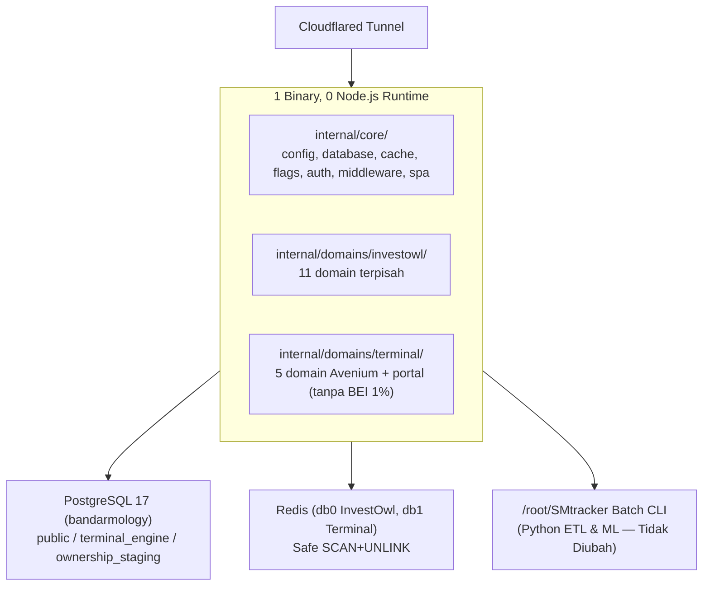

# LazyTrader — Arsitektur Modular Anti-Monolith

## 1. Gambaran Sistem



## 2. Struktur Direktori Backend (`backend/`)

```text
backend/
├── cmd/server/main.go                 # Thin wiring entry point (<120 LOC)
└── internal/
    ├── core/
    │   ├── config/                    # Env & allowlist config
    │   ├── database/                  # pgxpool tuned untuk 3.6 GB ARM64
    │   ├── cache/                     # L1 bounded LRU+TTL + L2 Redis (db0/db1) + SafePurge
    │   ├── flags/                     # Parser /root/SMtracker/config/feature_flags.yaml
    │   ├── auth/                      # Google OAuth2 + HS256 HttpOnly cookie + admin/gate guards
    │   ├── middleware/                # Security headers, CORS, GZip, Redis rate limiter
    │   ├── httpx/                     # JSON response & FastAPI-compatible error envelope
    │   └── spa/                       # Static Vite SPA server & legacy redirects
    ├── domains/investowl/
    │   ├── health/                    # /api/health & /api/v1/terminal/health
    │   ├── users/                     # /api/users/* (models, repository, handler, routes)
    │   ├── stocks/                    # Fase 3
    │   ├── broker/                    # Fase 3
    │   ├── bandarmology/              # Fase 3
    │   ├── signal/                    # Fase 3
    │   ├── foreign_flow/              # Fase 3
    │   ├── forensic/                  # Fase 3 (Canary Exodus 45/45 parity)
    │   ├── ownership/                 # Fase 3
    │   ├── shareholders/              # Fase 3
    │   ├── nyangkut/                  # Fase 3
    │   └── system/                    # Fase 3 (SMtracker subprocess runner & cache purge)
    └── domains/terminal/
        ├── portal/                    # /api/v1/terminal/portal/* (tanpa bei1persen)
        ├── mmd/                       # Fase 3
        ├── foreign_flow_pro/          # Fase 3
        ├── konglo/                    # Fase 3
        ├── ipo_hunter/                # Fase 3 (SQL-backed + Redis cache, tanpa heap dict 281 MB)
        └── market_report/             # Fase 3 (Admin-protected)
```

## 3. Struktur Direktori Frontend (`frontend/src/`)

```text
frontend/src/
├── main.tsx & App.tsx                 # React Router + AuthProvider + RouteGuard
├── styles/globals.css                 # 100% token MD3 InvestOwl
├── lib/                               # auth.tsx, format.ts, api/client.ts
├── store/useAppStore.ts               # Zustand persisted global state
├── components/
│   ├── layout/                        # ClientLayout, Sidebar, BottomNav, TerminalDropdown, ThemeToggle, RefreshButton, LogoutButton
│   └── ui/                            # CacheLoadingOverlay, FeaturePlaceholder, reusable MD3 cards
└── features/
    ├── auth/                          # LoginPage, PendingPage
    ├── admin/                         # AdminPage
    ├── home/, ticker/, signal/, foreign/, ownership/, group/, explorer/   # InvestOwl pages (Fase 4)
    └── mmd/, ipo-hunter/, foreign-pro/, konglo/, market-report/           # Avenium modules dipecah modular (Fase 4)
```

## 4. Hilangnya HTTP Loopback Auth
Sebelumnya, FastAPI `:8001` memanggil `http://127.0.0.1:3001/api/auth/session` ke NextAuth di setiap request terproteksi. Di LazyTrader, Go backend langsung memverifikasi cookie `lazytrader_session` (HS256 JWT HttpOnly) dan menyinkronkan user ke `public.users`, sehingga frontend murni static SPA dan latensi auth turun ke <0,1 ms.
